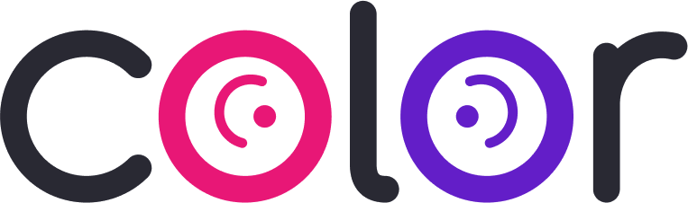
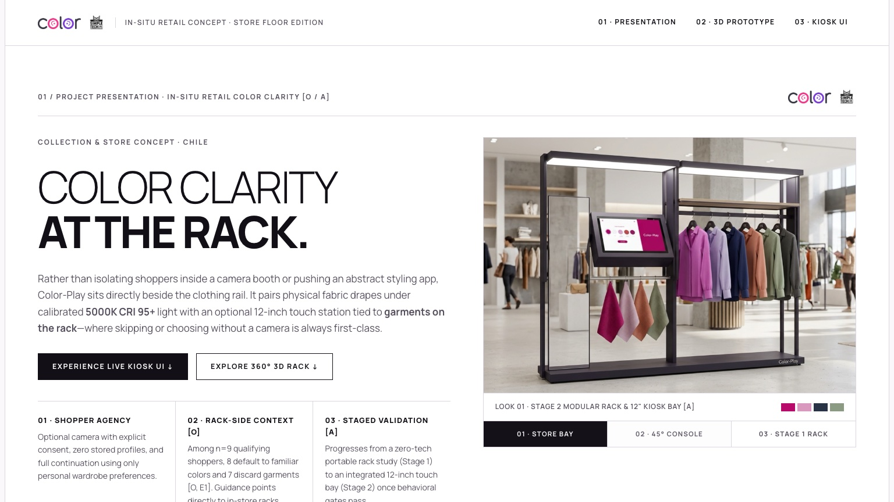
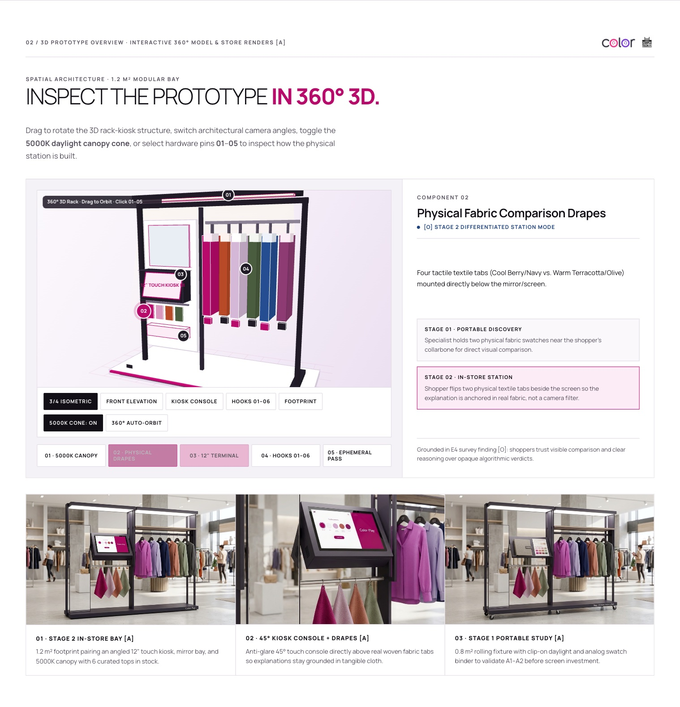
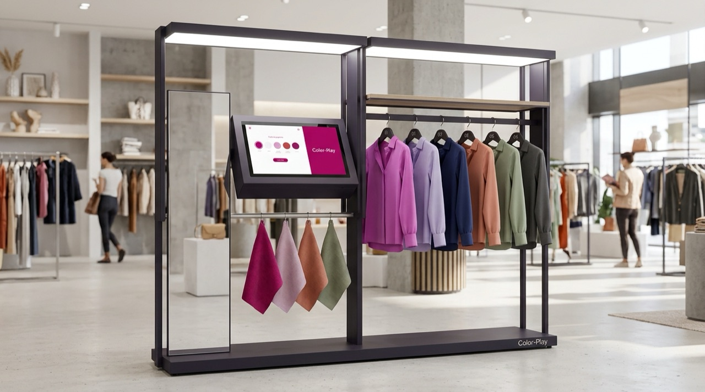
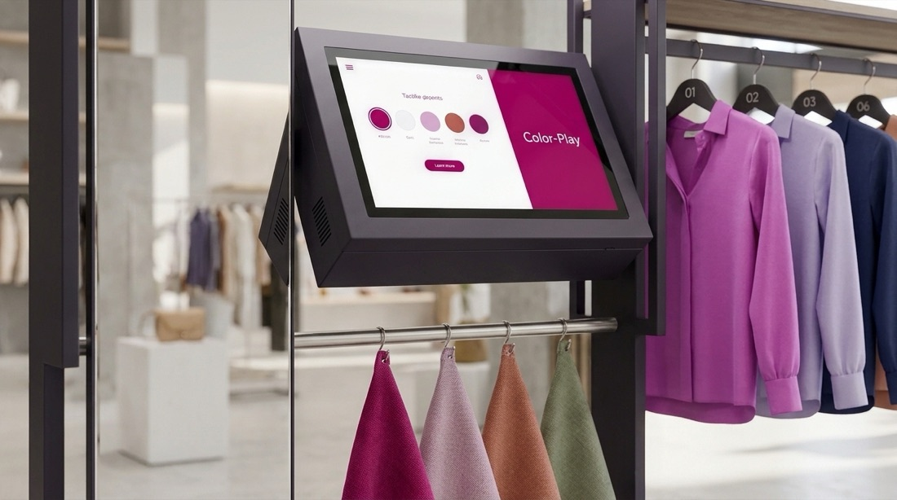
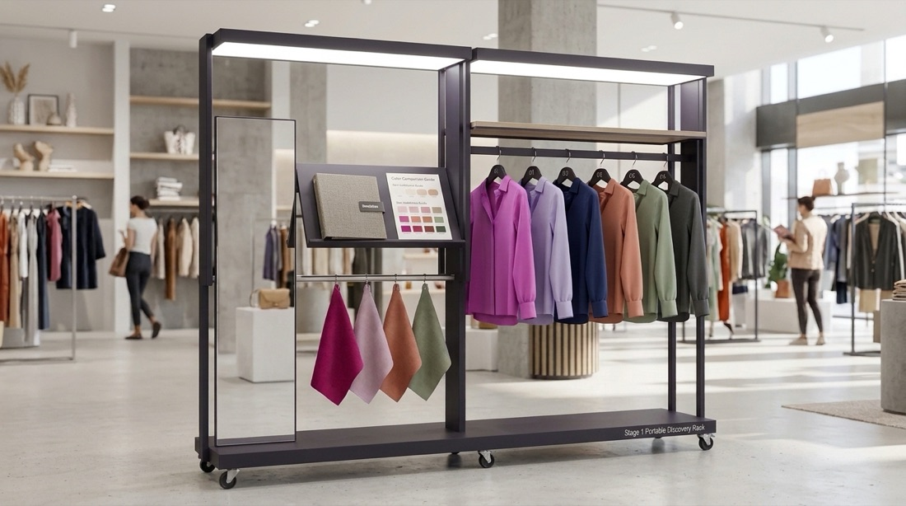
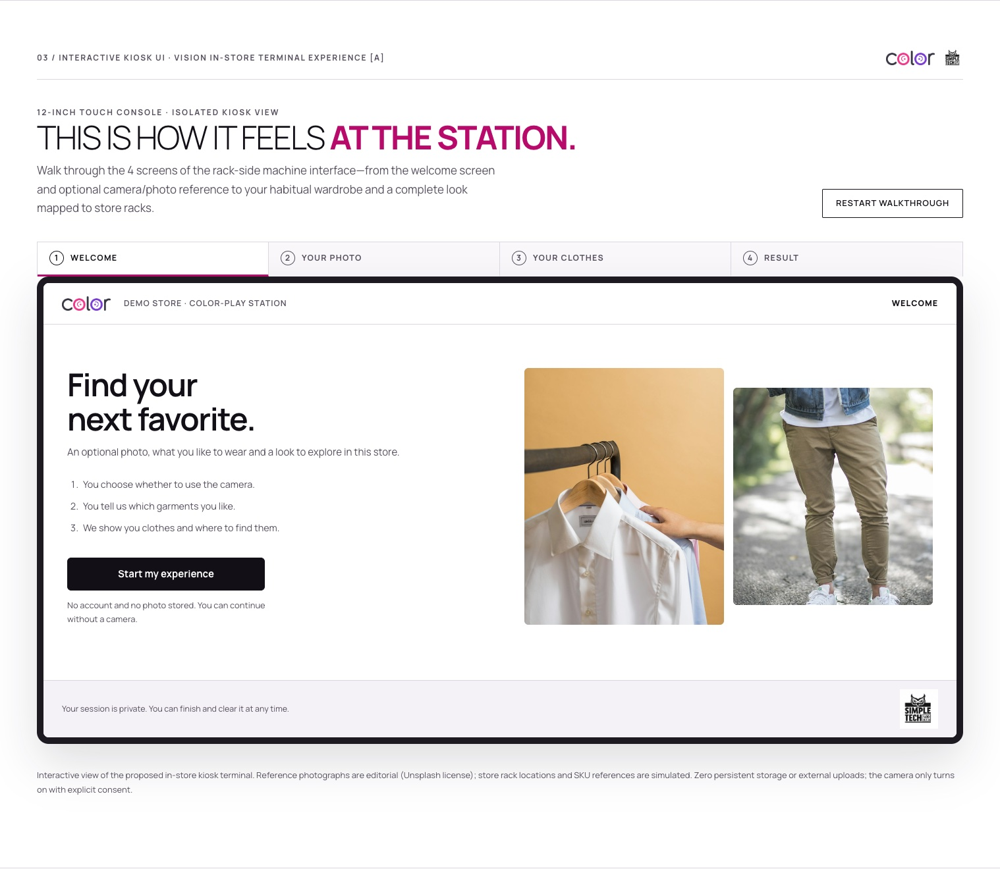
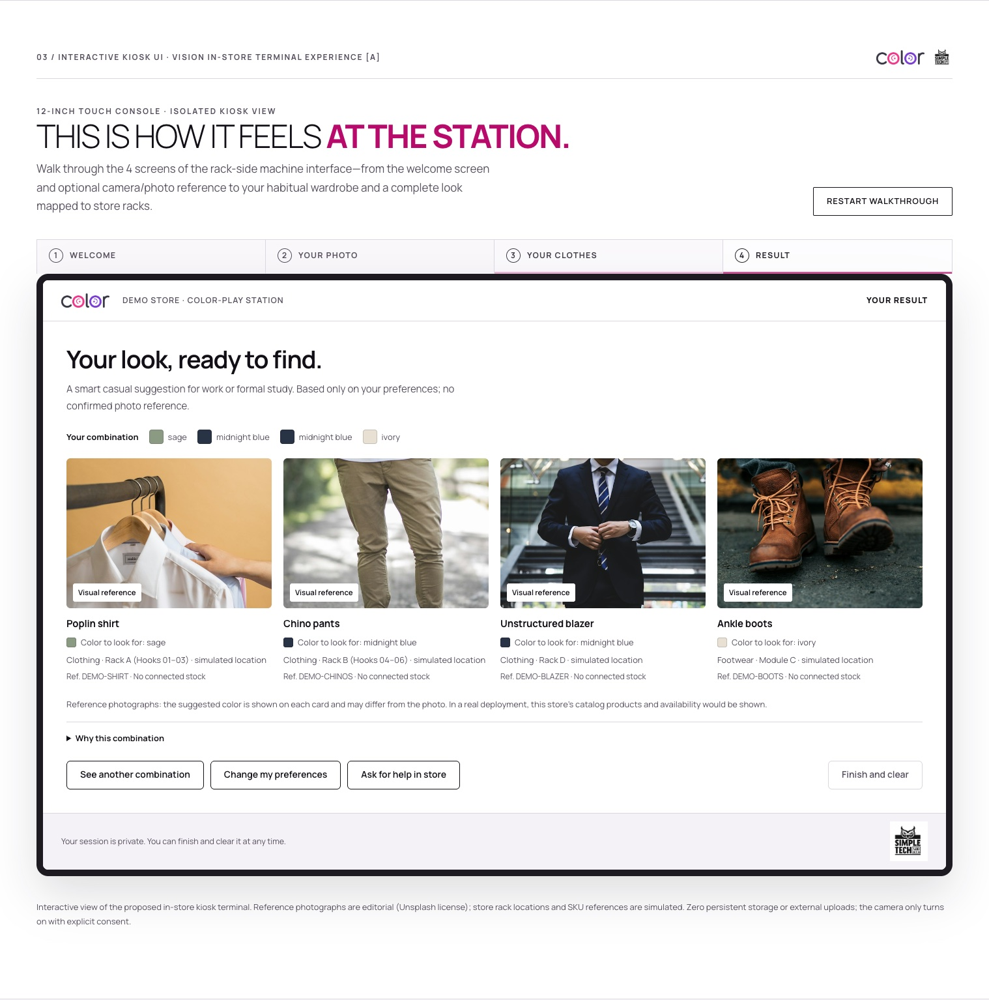

<div align="center">



# Color-Play — In-Situ Retail Concept, 3D Rack & Kiosk UI

**Editorial web prototype demonstrating how Color-Play fits, operates, and guides shoppers beside the garment rack inside Chilean fashion retail stores.**

[](https://nicogouet5.github.io/Color-Play/)
[](work/tsconfig.json)
[](ENTREGA_FINAL_v12/Color-Play_InStore_Prototype_Standalone.html)
[](work/check_instore_prototype.cjs)

[**Launch Live Prototype ↗**](https://nicogouet5.github.io/Color-Play/) · [**Open Vision Color Lab (`vision/`) ↗**](https://nicogouet5.github.io/Color-Play/vision/) · [**Stitch Canvas ↗**](https://stitch.google.com/projects/5268539669621980793)

</div>

---

<p align="center">
  
</p>

## Overview

Rather than isolating shoppers in a camera booth or pushing an abstract mobile app, **Color-Play** sits directly beside the apparel rail. It pairs **physical textile drapes** under calibrated **5000K CRI 95+** illumination with an **angled 12-inch touch kiosk** tied to real garments on the rack (`Hooks 01–06`)—where continuing without a camera or skipping is always treated as a first-class choice.

This repository deploys a **3-chapter editorial web experience** directly to GitHub Pages, built as a single offline-capable HTML bundle ([`index.html`](index.html)) compiled with strict TypeScript and modern CSS.

---

## Experience Architecture

| Chapter | Anchor | What It Demonstrates |
| :--- | :--- | :--- |
| **01 · Project Presentation** | `#presentation` | Editorial concept framing, **3D lookbook switcher**, and interactive comparison of **Stage 01** (Portable Rack Study), **Stage 02** (Rack-Side Kiosk Station), and **Stage 03** (Cross-Category Bridge). |
| **02 · 360° 3D Prototype** | `#fixture-3d` | Real-time interactive **360° Canvas 3D viewer** ([`rack3d.ts`](work/src/rack3d.ts)) with 5 camera presets (`3/4 Isometric`, `Front Elevation`, `Kiosk Console`, `Hooks 01–06`, `Footprint`), clickable hardware pins `01`–`05`, toggleable **5000K daylight cone**, and photorealistic store renders. |
| **03 · Isolated Kiosk UI** | `#kiosk-ui` | Embedded 4-step **12-inch Rack-Side Kiosk interface** ([`vision-kiosk.ts`](work/src/vision-kiosk.ts)) adapted from `vision/`: *1. Welcome → 2. Optional Photo → 3. Wardrobe Interview → 4. Coordinated Store Look*. |

---

## Visual Showcase

### Chapter 02 — Interactive 360° 3D Rack & Industrial Store Renders

<p align="center">
  
</p>

<table>
  <tr>
    <td width="33%" align="center">
      
      <sub><strong>01 · Stage 2 In-Store Bay</strong><br>1.2 m² modular bay with 5000K canopy</sub>
    </td>
    <td width="33%" align="center">
      
      <sub><strong>02 · 45° Kiosk Console</strong><br>Anti-glare display above woven drapes</sub>
    </td>
    <td width="33%" align="center">
      
      <sub><strong>03 · Stage 1 Portable Rack</strong><br>0.8 m² rolling fixture before hardware capex</sub>
    </td>
  </tr>
</table>

### Chapter 03 — Live In-Store Kiosk Interface

<table>
  <tr>
    <td width="50%" align="center">
      
      <sub><strong>Screen 1 · Shopper Invitation</strong><br>Clear agency rules &amp; zero-profile guarantee</sub>
    </td>
    <td width="50%" align="center">
      
      <sub><strong>Screen 4 · Rack Result</strong><br>Outfit mapped to simulated store racks (`Hooks 01–06`)</sub>
    </td>
  </tr>
</table>

---

## Privacy, Evidence & Hardware Guardrails

- **Privacy by Design:** Zero facial detection, zero biometric classification, zero persistent profiles, and zero external API uploads. Optional camera frames remain strictly in browser memory and clear immediately on exit (`Finish and clear`).
- **Evidence Discipline (`[O]` vs `[A]`):** Explicitly separates **Observed** survey baseline data (`[O]`, `n=9` qualifying shoppers where `8/9` default to familiar colors and `7/9` discard garments) from **Proposed** hardware hypotheses and validation gates (`[A]`).
- **Accessibility & Self-Containment:** Embedded `Manrope` typography, `data:` URI assets (`3.6 MiB` single-file standalone), keyboard-accessible tabs and 3D controls, `prefers-reduced-motion` support, and `0` Axe WCAG 2 A/AA violations.

---

## Repository Structure

```text
Color-Play/
├── index.html                           # Compiled GitHub Pages entry (self-contained single file)
├── ENTREGA_FINAL_v12/
│   ├── Color-Play_InStore_Prototype_Standalone.html  # Offline distribution mirror
│   ├── Logo_Color.png                   # Brand mark
│   └── Manrope-OFL.txt                  # Font license
├── docs/preview/                        # Editorial screenshots embedded in this README
├── work/                                # Prototype source, builder, 3D assets & Playwright QA
│   ├── src/
│   │   ├── instore-prototype.ts         # Chapter interactions, tabs, hotspot sync & scroll fallback
│   │   ├── rack3d.ts                    # Real-time 360° Canvas 3D projection engine & pins 01–05
│   │   ├── vision-kiosk.ts              # Isolated 4-step Vision Kiosk UI (CIELAB + wardrobe engine)
│   │   ├── data.ts                      # Stage blueprints, hardware specs & shopper scenarios
│   │   ├── types.ts                     # Strict TypeScript domain contracts
│   │   └── instore-prototype.css        # Editorial stylesheet & CSS Scroll-Driven Animations
│   ├── assets/                          # 3D architectural renders & Stitch verification captures
│   ├── build_prototype.mjs              # TypeScript typechecker, bundler & HTML emitter
│   └── check_instore_prototype.cjs      # Playwright (1536px–320px + 200% zoom) & Axe WCAG AA audit
├── vision/                              # Full standalone Computer Vision & Wardrobe Studio lab
├── DESIGN.md                            # Editorial visual system tokens
└── PRODUCT.md                           # Product scope, `[O]`/`[A]` evidence rules & guardrails
```

---

## Local Development & Verification

All commands run with Node.js (v20+) and local Google Chrome for Playwright checks:

```sh
# 1. Install build & verification dependencies (first time only)
npm ci --prefix work

# 2. Typecheck TypeScript, bundle assets, and emit index.html + standalone HTML
npm --prefix work run build:prototype

# 3. Run full automated QA (5 responsive viewports, 200% zoom, 3D/Kiosk flows, Axe WCAG A/AA, 0 network calls)
npm --prefix work run check:prototype

# 4. Run unit tests for the underlying Vision CIELAB & wardrobe recommendation engines
npm --prefix vision test
```

> **Note:** Opening [`index.html`](index.html) directly from disk or deploying via `.github/workflows/deploy-pages.yml` requires zero external network requests. The full Computer Vision Studio with live image pixel sampling is also available standalone in [`vision/`](vision/).

---

## Team & Credits

- **Authors:** Nicolas Inostrosa · Valeria Ravanal · Rocio Torres — *Product Management I (Simple Tech / UDD MTI)*
- **Reference Apparel Photography:** Curated Unsplash assets documented in [`vision/assets/photo-sources.json`](vision/assets/photo-sources.json)
