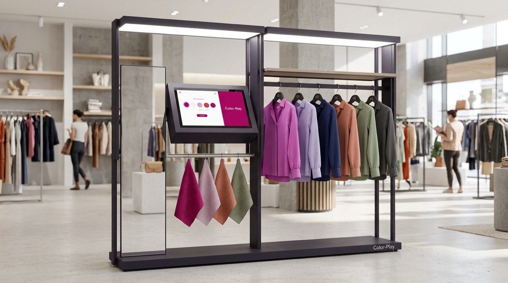
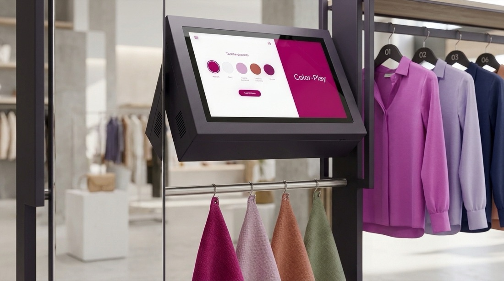
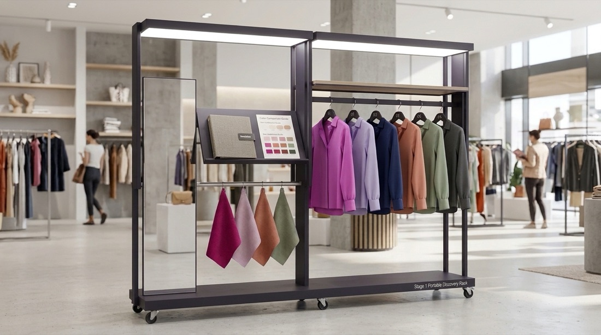
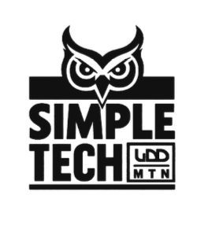

<div align="center">
  
  <h1>Color-Play × Ripley</h1>
  <p><strong>Color clarity at the rack. Better buys for Ripley.</strong></p>
  <p>
    <a href="https://nicogouet5.github.io/Color-Play/"><strong>🚀 Open Live Prototype</strong></a> ·
    <a href="docs/COLOR_PLAY_ALIGNMENT_v2.md">Strategy v2</a> ·
    <a href="docs/ColorPlay%20x%20Ripley.md">Strategy &amp; Brand</a> ·
    <a href="docs/IMPLEMENTATION_V2.md">Implementation &amp; Limits</a> ·
    <a href="privacy.html">Privacy</a>
  </p>
</div>

> [!NOTE]
> A computer-vision kiosk proposal for **Ripley's physical apparel stores**: a color reference and clothing taste profile guide shoppers toward garments, while a proposed purchase-linked data loop helps Merchants learn across **color × size × style**.
> **Ripley is the proposed buyer, not a confirmed partner.**

<p align="center">
  
</p>

---

## ✨ What's Inside the Prototype

| Experience | Flow | Key Highlights |
|---|---|---|
| **First Visit** | `RUT` → `Consent` → `Color Test` → `Tastes & Size` → `Aisles` → `QR` | Local camera/image color extraction or sample color test, garment wayfinding, and printable offline QR ticket. |
| **Returning Shopper** | `RUT` → `Saved Demo Profile` → `Aisle Recommendations` | Instant access to saved demo palette, tastes, editable/hideable size, and recent sample purchases (per-store toggle). |
| **Checkout Demo** | `Scan Ticket` → `Select Bought Items` → `Discount Tiers` | Simulates `3% → 5% → 8%` non-additive tiers, blocks duplicate scans locally, and previews optional **Puntos Go** enrollment. |
| **Merchant Loop** | `Session` → `Mock Checkout` → `Mock CRM` | Displays purchased vs. unpurchased shortlist items without exposing RUT or inferring causal non-purchase reasons. |
| **3D Store & Kiosk Explorer** | `2-Floor Store Map` → `In-Model Zoom` → `Full Fixture 3D` | Interactive two-floor cutaway (**Floor 1 · Women's** & **Floor 2 · Men's**), escalators, fitting rooms, checkouts, and click-to-zoom kiosks. |

---

## 🧪 Try the Demo

1. Open the [**Live Prototype**](https://nicogouet5.github.io/Color-Play/).
2. Choose **“I want to see what could suit me”** (first visit, left) or **“What's new for me?”** (returning, right) — stacked in the same order on mobile.
3. Enter the demo RUT **`11.111.111-1`** and accept the local-demo consent.
4. Scroll to **Explore the store concept** to orbit the 2-floor Ripley layout, isolate **Floor 1** or **Floor 2**, click any **Color-Play pin (`L1` / `L2`)** to zoom inside the model, or inspect the full 3D kiosk fixture.

> [!IMPORTANT]
> **Do not enter a real RUT.** No RUT, photo, or profile is transmitted or persistently stored. The generated QR contains no RUT. Finishing, resetting, hiding the tab, reloading, or **3 minutes of idle time** clears the local session. A RUT is an identifier, not authentication.

---

## 🔍 What Is Real vs. Simulated

| Functional in this browser | Not connected or validated |
|---|---|
| RUT check digit, consent, and memory-only identifier link | Customer authentication or Ripley customer lookup |
| Local image-color extraction and preference filtering | Validated skin colorimetry or 5000K calibration |
| Editable size, sample-stock no-match, and aisle display | Live inventory, real SKUs, or actual store floor plans |
| Genuine offline QR, print-only ticket, and local duplicate-scan block | POS redemption, real discounts, or cross-device deduplication |
| Local mock purchase/CRM events | Ripley CRM, purchase attribution, or actual Puntos Go enrollment |

---

## 🏬 Concept Renders

<table>
  <tr>
    <td align="center" width="33%">
      <br />
      <sub><strong>Store Bay Concept</strong><br />Illustrative retail placement</sub>
    </td>
    <td align="center" width="33%">
      <br />
      <sub><strong>Kiosk Enclosure</strong><br />Interactive terminal &amp; camera</sub>
    </td>
    <td align="center" width="33%">
      <br />
      <sub><strong>Stage 1 Portable Rack</strong><br />Study fixture before integration</sub>
    </td>
  </tr>
</table>

---

## 💼 Current Strategy

Color-Play is a **sell-then-embed proposal** for Ripley. Commercial scenarios and negotiation assumptions are kept out of this public overview. The detailed strategy is documented separately and should be shared only with its intended audience.

*Ripley is a proposed buyer, not a confirmed partner. Amounts, projections, and IP-transfer terms are illustrative assumptions, not a deal or validated forecast. No patentability is asserted without INAPI/legal review.*

---

## 🛠️ Local Development

Requires **Node 22**. No extra runtime dependencies are needed for the QR generator (Project Nayuki's MIT generator is vendored with its license).

```sh
npm ci --prefix work
npm --prefix work run typecheck
npm --prefix work run build:prototype
npm --prefix work run check:prototype
python3 -m http.server 8765 --bind 127.0.0.1
```

Open `http://127.0.0.1:8765/`. Browser checks use Chrome on macOS by default (`CHROME_PATH` can override it elsewhere). GitHub Actions installs from the lockfile, typechecks, builds, and deploys only `dist/` on push to `main`.

---

## 📁 Repository Structure

```text
.
├── index.html                   # Generated self-contained prototype entry
├── privacy.html                 # Demo privacy and retention notice
├── credits.html                 # Asset credits and limits
├── docs/                        # Strategy v2, implementation, privacy, and QA records
├── dist/                        # Generated GitHub Pages artifact (gitignored)
└── work/
    ├── build_prototype.mjs      # Self-contained HTML/CSS/JS bundler
    ├── check_instore_prototype.cjs  # Playwright, Axe, QR, and privacy checks
    ├── assets/                  # Logos, 3D concept renders, and catalog photos
    └── src/                     # TypeScript kiosk UI, offline QR, 3D store map & fixture
```

---

<div align="center">
  
  <p><strong>Team:</strong> Nicolas Inostrosa · Valeria Ravanal · Rocio Torres · Simple Tech / UDD</p>
</div>
